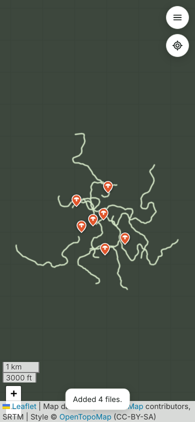
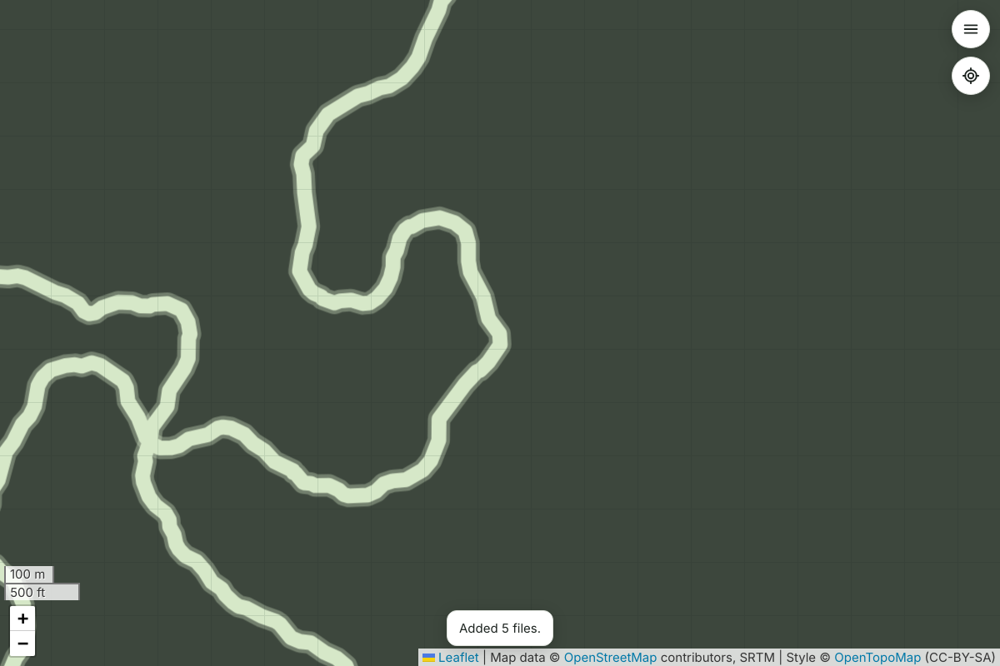

# Foraging Fog Map

A map that is covered in fog everywhere except where you've walked. Every GPS track you record clears a strip of fog, so after a few seasons you can see at a glance which parts of the forest you've already covered, and which you haven't. Your foraging spots sit on top as pins.

<p>
  
  
</p>

*(Screenshots use the made-up sample data in `samples/` and a plain placeholder in place of map tiles.)*

**Using Lifeng's copy of the map as a tester?** Follow [USING.md](USING.md), a step-by-step guide that needs no setup.

- Works in any modern browser, on a phone in the field or on a computer.
- Reads GPX, KML, KMZ, FIT and ZIP files, including Garmin Connect activities, Garmin Explore exports and Garmin's full account data export.
- Your data stays private. It lives in your own Google Drive folder (or on your device) and is never put in this repository or sent anywhere else.
- Free to host on GitHub Pages. There is no server and no database.

## How your data stays private

This repository holds only the app's code. Your tracks and spots never go in it.

- **Google Drive:** the app signs in to Google from your browser with read-only access and downloads the files from the one folder you choose. Nobody else, including whoever hosts the site, can see them.
- **On your device:** the app keeps a copy of what it has read in your browser's storage, so the map opens instantly and works without signal. **Settings → Remove all data from this device** deletes it.
- **Adding files directly:** files you pick or drop on the map are read in the browser and never uploaded.
- The `.gitignore` blocks GPX, KML, KMZ, FIT and ZIP files, so they can't be committed by accident. Only the made-up files in `samples/` are tracked.

The Google client ID in `js/config.js` is not a secret. It only works on the web addresses you allow for it.

## Try it without any setup

1. Open the site (yours once you've set it up, or run it on your computer as described under [Run it on your computer](#run-it-on-your-computer)).
2. Tap the menu button (☰), then **Add files**.
3. Pick the files in the `samples/` folder of this repository.

The fog clears along made-up walks in a forest, and the made-up spots appear.

## Getting your tracks out of Garmin

Any of these works. Put the files in your Drive folder, or add them directly.

- **Garmin account data export (everything at once, best for years of hikes):** sign in at garmin.com, open **Account → Data Management → Export Your Data**, and request an export. Garmin emails you a link to a ZIP file, which can take a few days. Put the whole ZIP in your Drive folder; the app finds the activity files inside it. Garmin Connect activities are in the export as FIT files, in zips under `DI_CONNECT/DI-Connect-Uploaded-Files`.
  - If the export is very large (more than a few hundred MB), a phone may run out of memory reading it. Unzip it on a computer and put only the zips from `DI_CONNECT/DI-Connect-Uploaded-Files` in your Drive folder.
- **A single Garmin Connect activity:** open it on connect.garmin.com, click the gear icon and choose **Export Original** (a ZIP with the FIT file) or **Export to GPX**.
- **Garmin Explore app:** open **Saved**, pick an activity, track or collection, then **Share → GPX** and save it to your Drive folder.
- **Explore website:** **Map → Export** gives you KML or GPX, but Garmin refuses tracks with more than 500 points, which most walks have. Use one of the options above instead.

Only activities done on foot clear fog: hikes, walks, runs, mountaineering, hunting, fishing, snowshoeing, and activities with no sport set. Rides, drives, paddling, skiing and other sports in your Garmin data are skipped, so they don't clear fog along roads and rivers. Planned courses are skipped too.

Tracks that appear in several files (for example in a single-trip GPX and again in the full export) are counted once.

## Set up your own copy

You need a free GitHub account and a Google account. No programming is needed. Allow about 20 minutes the first time.

### 1. Put the code on GitHub and turn on GitHub Pages

1. On this repository's GitHub page, click **Fork** (or **Use this template**). This makes your own copy.
2. In your copy, open **Settings → Pages**.
3. Under **Build and deployment**, set **Source** to **Deploy from a branch**, pick the **main** branch and the **/ (root)** folder, and click **Save**.
4. After a minute or two, the page shows your site's address, something like `https://your-username.github.io/foraging-fog-map/`. Open it to check it loads.

At this point the map already works with files you add directly. The next part connects Google Drive.

### 2. Create a Google client ID (for Drive)

Google needs to know which website is allowed to ask for access to your Drive. This is free and needs no billing.

1. Go to [console.cloud.google.com](https://console.cloud.google.com) and sign in with the Google account that holds your Drive folder.
2. Create a project: click the project picker at the top, then **New project**. Name it `Foraging Fog Map` and click **Create**. Make sure it's selected.
3. Turn on the Drive API: open **APIs & Services → Library**, search for **Google Drive API**, open it and click **Enable**.
4. Set up the sign-in screen: open **APIs & Services → OAuth consent screen** (it may be called **Google Auth Platform**) and click **Get started**.
   - **App name:** `Foraging Fog Map`. **User support email:** your email.
   - **Audience:** choose **External**.
   - **Contact information:** your email. Agree to the policy and click **Create**.
5. Add yourself as a tester: open **Audience**, find **Test users**, click **Add users**, enter your Google email and save. Leave the app in **Testing**; it doesn't need to be published.
6. Allow read-only Drive access: open **Data Access**, click **Add or remove scopes**, tick `.../auth/drive.readonly` (search for "drive.readonly" if you need to), click **Update**, then **Save**.
7. Create the client ID: open **Clients** (or **APIs & Services → Credentials → Create credentials → OAuth client ID**).
   - **Application type:** **Web application**. **Name:** `Fog map site`.
   - Under **Authorized JavaScript origins**, click **Add URI** and enter your GitHub Pages origin: `https://your-username.github.io` (just that, with no folder after it and no slash at the end). Add `http://localhost:8000` too if you'll run it on your computer.
   - Leave **Authorized redirect URIs** empty and click **Create**.
8. Copy the **Client ID**. It ends in `.apps.googleusercontent.com`.

### 3. Put the client ID in your copy

1. In your GitHub repository, open `js/config.js` and click the pencil icon to edit it.
2. Paste your client ID between the quotes: `export const GOOGLE_CLIENT_ID = '1234-abcd.apps.googleusercontent.com';`
3. Click **Commit changes**. Your site updates within a minute or two.

(Alternatively, paste it into the app under **Settings → Google client ID**. That only applies to the browser you paste it in.)

### 4. Make your Drive folder

1. In Google Drive, create a folder called **Foraging map data**. (Any name works; enter it, or the folder's link, under **Settings → Google Drive folder** in the app.)
2. Put your GPX, KML, KMZ or ZIP files in it. Subfolders, for example one per year, are fine.

### 5. Sync

Open your site, tap ☰, then **Sync Google Drive**.

- Google shows **"Google hasn't verified this app"**. That's expected for a personal app; it's your own. Click **Continue**.
- Approve **See and download all your Google Drive files**. The app can only read, never change or delete anything, and it only downloads files from your chosen folder.

After the first sync, the sync button (⟳) appears beside the menu. Tap it whenever you've added new trips; only new or changed files are downloaded, and files you remove from the folder disappear from the map.

Because the Google project stays in Testing, Google may ask you to approve again from time to time. That's normal.

## Using it in the field

- **Add it to your home screen** (Safari: Share → Add to Home Screen; Chrome: ⋮ → Add to Home screen). It then opens like an app.
- **Without signal:** your tracks, spots and the app itself are stored on the phone, so they still show. Map tiles only show for areas the browser has recently loaded, so open the area once while you have signal before you go.
- **◎** shows where you are, so you can see whether you're standing in fog.

## Settings

| Setting | What it does |
|---|---|
| Cleared strip width | How wide a strip each walk clears (15–500 ft, or 5–150 m; default 100 ft). |
| Fog darkness | How dark the fog is; lower it to see the map underneath. |
| Walks from / to | Only clear fog for walks in those years (to see what you haven't revisited lately). Walks without dates always count. |
| Map | USGS topographic map with contours in feet (US only), OpenTopoMap with contours in metres, or a street map. Until you pick one, it follows the Units setting. |
| Units | Miles and feet (the default), or kilometres and metres. |
| Hide location | For screenshots: hides the base map and spot names, spot coordinates and the scale bar, so the picture shows the fog and walks but not where they are. Tap **Location hidden · Show** to turn it off. The shape of a trail could still be matched to a map by someone who tried hard. |
| Show spots / walk lines | Toggle the pins, and thin lines along the exact walks. |
| Only show spots matching | Show only spots whose name or note contains a word, e.g. "chanterelle". |

## Good to know

- **Routes are ignored.** Planned routes (GPX `<rte>`) don't clear fog, only recorded tracks. KML files don't say which lines are planned and which were walked, so all KML lines count as walks.
- **GPS jumps are skipped.** If two consecutive points are more than 500 m apart (the device was off, or lost signal), the strip isn't drawn across the gap.
- **Pauses aren't bridged.** When you pause the watch and resume somewhere else, the strip isn't drawn between the two places.
- **Map tiles** come from the USGS National Map, OpenStreetMap and OpenTopoMap. The USGS map covers the United States only; elsewhere, switch to OpenTopoMap. OpenStreetMap and OpenTopoMap are free community services, so please keep usage personal and light.

## Run it on your computer

It's a plain static website with no build step. From the repository folder:

```
python3 -m http.server 8000
```

then open http://localhost:8000. (Opening `index.html` directly from the disk doesn't work, because browsers block modules on `file://` pages.)

## Development

- `js/parse.js`: GPX, KML, KMZ and ZIP reading (no dependencies; runs in browsers and Node).
- `js/fit.js`: Garmin FIT activity reading (GPS records, pauses, sport).
- `js/geo.js`, `js/data.js`: simplification, gap splitting, de-duplication and stats.
- `js/fog.js`: the fog layer, a Leaflet canvas that's filled with fog and then has each walk erased from it. Tracks are pre-projected and simplified per zoom level, so years of walks stay smooth.
- `js/drive.js`: Google sign-in (token kept in memory only) and Drive folder reading.
- `js/store.js`: the on-device cache (IndexedDB).
- `sw.js`: keeps the app available offline.
- `vendor/leaflet/`: Leaflet 1.9.4, included so the site has no outside script dependencies.

Tests:

```
npm test                         # parsing and geometry (Node 22+)
npm install
npx playwright install chromium
npm run test:browser             # the whole app in headless Chromium, including a Drive sync against a fake Google
```

`npm run samples` regenerates the made-up sample files, including the FIT files (written by `tools/fit.mjs`).

## Credits and licenses

- This project: MIT (see `LICENSE`).
- [Leaflet](https://leafletjs.com): BSD 2-Clause (`vendor/leaflet/LICENSE`).
- Map data © [OpenStreetMap](https://www.openstreetmap.org/copyright) contributors (ODbL). Topographic style © [OpenTopoMap](https://opentopomap.org) (CC-BY-SA). US topographic tiles courtesy of the [U.S. Geological Survey](https://www.usgs.gov/) (The National Map).
